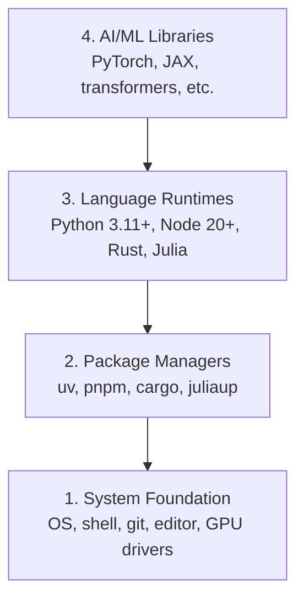

# 开发环境

> 工具会影响你的思考方式。花一次时间，把环境搭好。

**类型：** 动手实践
**语言：** Python、Node.js、Rust
**前置要求：** 无
**预计时间：** 约 45 分钟

## 学习目标

- 从零搭建 Python 3.11+、Node.js 20+ 和 Rust 工具链。
- 配置虚拟环境与包管理器，让构建可以复现。
- 使用 CUDA/MPS 检查 GPU 是否可用，并运行一次张量测试。
- 理解环境的四个层次：系统基础、包管理器、语言运行时、AI 库。

## 要解决的问题

接下来的五百多课会使用 Python、TypeScript、Rust 和 Julia。环境一旦出问题，每一课都可能变成排查工具故障，而不是学习 AI 工程。

很多人会跳过环境配置，之后再花几个小时解决导入错误、版本冲突和缺少 CUDA 驱动的问题。这一课先把基础环境配置好。

## 核心概念

AI 工程环境分为四层：



安装从底层向上进行。每一层都依赖下面的基础。

```figure
s0-env-stack
```

## 动手配置

### 第 1 步：系统基础

检查系统，并安装基本工具。下面按操作系统分别列出命令，不需要全部执行。

```bash
# macOS
xcode-select --install
brew install git curl wget

# Ubuntu/Debian
sudo apt update && sudo apt install -y build-essential git curl wget unzip

# Windows (use WSL2)
wsl --install -d Ubuntu-24.04
```

### 第 2 步：用 uv 配置 Python

原课程选择 `uv` 管理 Python 和虚拟环境。uv 官方以特定依赖安装基准说明其相对 pip 的 10–100 倍速度优势；这不是每一次安装都会达到的保证。

```bash
curl -LsSf https://astral.sh/uv/install.sh | sh

uv python install 3.12

uv venv
source .venv/bin/activate  # or .venv\Scripts\activate on Windows

uv pip install numpy matplotlib jupyter
```

检查 Python 版本、NumPy 版本和一次向量点积：

```python
import sys
print(f"Python {sys.version}")

import numpy as np
print(f"NumPy {np.__version__}")
a = np.array([1, 2, 3])
print(f"Vector: {a}, dot product with itself: {np.dot(a, a)}")
```

### 第 3 步：配置 Node.js 和 pnpm

TypeScript 课程会用到它们，例如 Agent、MCP 服务器和 Web 应用。

```bash
curl -fsSL https://fnm.vercel.app/install | bash
fnm install 22
fnm use 22

npm install -g pnpm

node -e "console.log('Node', process.version)"
```

fnm 安装器会先检查 `unzip`。如果缺少它，会输出 `Not installing fnm due to missing dependencies.` 并退出：Linux 上需要解压 ZIP，macOS 上则通过 Homebrew 安装。macOS 自带 `unzip`；Ubuntu、Debian 和 WSL2 可用第 1 步的 apt 命令安装。如果跳过了那一步，执行 `sudo apt install -y unzip`。

**macOS / Apple Silicon（原文列举 M1/M2/M3/M4）：** 如果遇到 `Error: Cannot install under Rosetta 2 in ARM default prefix (/opt/homebrew)`，说明终端正在 Rosetta 2 下运行（`arch` 输出 `i386`），而 Homebrew 是原生 arm64 版本。可按原文用 arm64 安装 fnm，配置 shell，再从上面的 `fnm install 22` 继续：

```bash
arch -arm64 brew install fnm
echo 'eval "$(fnm env --use-on-cd)"' >> ~/.zshrc
source ~/.zshrc
```

### 第 4 步：配置 Rust

性能敏感的课程，例如推理与系统实现，会使用 Rust。

```bash
curl --proto '=https' --tlsv1.2 -sSf https://sh.rustup.rs | sh

rustc --version
cargo --version
```

### 第 5 步：配置 Julia（可选）

部分数学课程使用 Julia。

```bash
curl -fsSL https://install.julialang.org | sh

julia -e 'println("Julia ", VERSION)'
```

### 第 6 步：检查 GPU（如果有）

**NVIDIA（Linux / Windows）：**

```bash
nvidia-smi

# Install PyTorch with CUDA
uv pip install torch torchvision torchaudio --index-url https://download.pytorch.org/whl/cu124
```

**macOS / Apple Silicon：** Mac 上没有 CUDA，这属于预期情况。不要给 Mac 的安装命令添加 `--index-url .../cuXXX`；这些 CUDA wheel 面向 Linux/Windows。安装常规版本，使用 Apple 的 MPS（Metal）后端：

```bash
uv pip install torch torchvision torchaudio
```

原文提供了跨平台的可用性检查：

```python
import torch
print(f"CUDA available: {torch.cuda.is_available()}")           # False on macOS — expected
print(f"MPS available:  {torch.backends.mps.is_available()}")   # True on Apple Silicon
if torch.cuda.is_available():
    print(f"GPU: {torch.cuda.get_device_name(0)}")
```

没有 GPU 也能开始。原课程说明，多数课程可以在 CPU 上运行；训练较重的课程可使用 Google Colab 或云 GPU。

### 第 7 步：检查你准备开始的学习路线

本课的课程验证命令需要在仓库根目录执行，也就是同时包含 `README.md` 和 `phases/` 的目录。预检只检查所选路线开始时必需的工具，默认跳过以后才会用到的依赖。

完整入门路线：

```bash
python3 phases/00-setup-and-tooling/01-dev-environment/code/verify.py --route beginner
```

也可以只检查某条路线：

```bash
python3 phases/00-setup-and-tooling/01-dev-environment/code/verify.py --route ml-foundations
python3 phases/00-setup-and-tooling/01-dev-environment/code/verify.py --route llm-engineering
python3 phases/00-setup-and-tooling/01-dev-environment/code/verify.py --route agents
python3 phases/00-setup-and-tooling/01-dev-environment/code/verify.py --route mcp
python3 phases/00-setup-and-tooling/01-dev-environment/code/verify.py --route agent-skills
python3 phases/00-setup-and-tooling/01-dev-environment/code/verify.py --route certification
```

加上 `--show-later`，同一个预检脚本也会检查后续课程的可选工具与依赖。缺少后续工具不应阻止你开始当前路线。

必需检查失败时，脚本会给出检测到的路径或导入错误，以及具体修正命令。Agent Skills 和认证路线还会提示人工检查宿主：Python 脚本无法证明 AI 宿主已经发现某个 Skill，也无法替你确认所选 Skill 安装范围可写。

入门路线预检通过时，原文展示的输出会指向第一课：

```text
Ready to start Beginner course.
Next: python3 phases/01-math-foundations/01-linear-algebra-intuition/code/vectors.py
```

## 后续如何使用

预检通过，意味着你可以开始所检查的路线。后续课程需要其他工具时再安装，不必为了备齐整套工具而停在第一课。

| 语言 | 原课程主要使用范围 | 包管理器 |
|---|---|---|
| Python | 阶段 1–12：机器学习、深度学习、NLP、视觉、音频、LLM | uv |
| TypeScript | 阶段 13–17：工具、Agent、多 Agent、基础设施 | pnpm |
| Rust | 阶段 12、15–17：性能敏感的系统 | cargo |
| Julia | 阶段 1：数学基础 | Pkg |

## 可复用产物

本课提供一个环境验证脚本，供学习者检查自己的配置。

`outputs/prompt-env-check.md` 中还有一份帮助 AI 助手诊断环境问题的提示词。

## 练习

1. 运行验证脚本，修复必需检查项的错误。
2. 为本课程创建 Python 虚拟环境，并安装 PyTorch。
3. 用四种语言分别写一个 Hello World，运行并检查输出。

## 本站校订与运行边界

- 本文对照固定版本英文逐段校订，修复中文草稿中「进口错误」「运行时间」「测试子操作」等误译及遗漏；代码块和原始图解 ID 保留。
- 安装命令需要联网，可能改变系统、全局包或 shell 配置；本文仅展示原课程命令，本站没有替你执行。执行远程安装脚本前，应核对官方来源、阅读脚本，并按自己的系统选择步骤。
- 原文版本要求属于该快照，不代表所有后续项目的最低版本一致。示例保留 Node 22、Python 3.12 和 CUDA 12.4 相关命令；具体课程与硬件兼容性应再核对。
- MPS 能否使用取决于硬件、macOS 和 PyTorch 构建，代码里的 `True on Apple Silicon` 注释不是对所有设备配置的保证。本站未运行本课示例。
- 上述 `certification` 路线命令是原文内容，本专辑不因此收录认证课程；预检通过也不等于模型训练或 GPU 性能已验证。

校核资料：[uv 官方说明](https://docs.astral.sh/uv/)、[PyTorch MPS 说明](https://docs.pytorch.org/docs/stable/notes/mps.html)。
