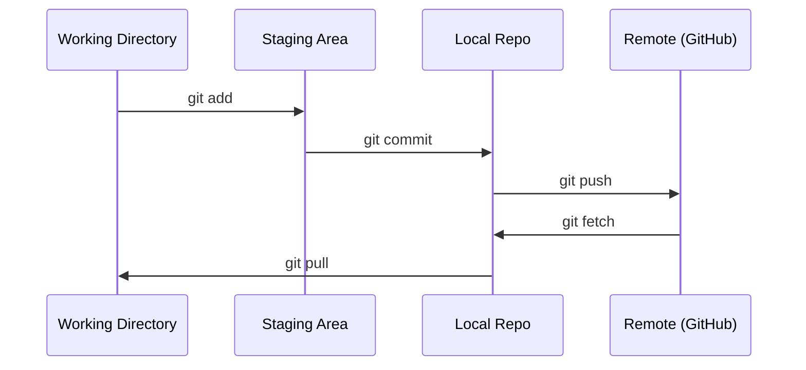

# Git 与协作

> 版本控制是必需的。这里的实验、模型和课程实现，都要留下可追溯记录。

**类型：** 概念学习
**语言：** 无特定语言
**前置要求：** 阶段 0，第 01 课
**预计时间：** 约 30 分钟

## 学习目标

- 配置 Git 提交身份，掌握日常的 add、commit、push 流程。
- 用分支隔离实验，再合并成果，避免直接影响主分支。
- 编写 `.gitignore`，排除模型检查点与大型二进制文件。
- 用 `git log` 阅读提交历史，理解项目如何演进。

## 要解决的问题

接下来的 20 个阶段会产生数百个代码文件。没有版本控制，就容易丢失成果、难以撤销错误，也难以和别人协作。

Git 负责版本管理；GitHub 可以托管仓库。这一课聚焦本课程需要的基本操作。

## 核心概念



记住三件事：

1. 经常提交，把学习进展存入本地仓库（`git commit`）。
2. 适时推送，保存一份远端副本（`git push`）。
3. 在分支上做实验（`git checkout -b experiment`）。

```figure
s0-commit-dag
```

## 动手操作

### 第 1 步：配置 Git

```bash
git config --global user.name "Your Name"
git config --global user.email "you@example.com"
```

### 第 2 步：日常流程

```bash
git status
git add file.py
git commit -m "Add perceptron implementation"
git push origin main
```

### 第 3 步：为实验创建分支

```bash
git checkout -b experiment/new-optimizer

# ... make changes, commit ...

git checkout main
git merge experiment/new-optimizer
```

### 第 4 步：在自己的课程仓库里学习

原课程仓库只有维护者有写权限，你不能直接向它推送。先在 GitHub 上 Fork 一份自己的副本，再克隆自己的仓库，让 `origin` 指向它：

```bash
git clone https://github.com/YOUR-USERNAME/ai-engineering-from-scratch.git
cd ai-engineering-from-scratch

git checkout -b my-progress
# work through lessons, commit your code
git push origin my-progress
```

## 日常使用

课程初期主要用到这些命令：

| 命令 | 用途 |
|---|---|
| `git clone` | 获取课程仓库 |
| `git add` + `git commit` | 把选定修改记录为本地提交 |
| `git push` | 将提交推送到 GitHub |
| `git checkout -b` | 为实验创建分支，隔离主分支 |
| `git log --oneline` | 查看简洁的提交历史 |

现在不需要掌握 rebase、cherry-pick 或子模块，也能开始学习。

## 练习

1. Fork 原仓库、克隆自己的副本，创建名为 `my-progress` 的分支，新增一个文件、提交并推送。
2. 创建 `.gitignore`，排除模型检查点文件（`.pt`、`.pth`、`.safetensors`）。
3. 用 `git log --oneline` 阅读原仓库的历史，看看课程是如何加入的。

## 关键术语

| 术语 | 常见说法 | 实际含义 |
|---|---|---|
| Commit · 提交 | “保存” | 记录某个时点的受版本控制项目快照及提交信息 |
| Branch · 分支 | “一份副本” | 指向某个提交、并随新提交向前移动的引用，不是复制整个目录 |
| Merge · 合并 | “把代码组合起来” | 整合分支历史与修改，必要时需要解决冲突 |
| Remote · 远端 | “云端” | 指向另一个仓库的配置，常见托管服务包括 GitHub、GitLab |

## 本站校订与运行边界

- 对照英文全文修复了草稿把 Git 译成「关键字」、把分支译成「部门」、把 Fork 译成「叉子」等错误，以及段落和术语表遗漏。
- 原文将 commit 简化为「整个项目的快照」：Git 实际记录受跟踪文件的索引状态，未暂存、未跟踪和被忽略的内容不会因此自动保存。推送同样不是把电脑上的所有文件备份到云端。
- 表中的 remote 补充了 Git 的配置含义；图解中的 fetch 与 pull 是简化流程，pull 通常包含获取远端更新及之后的整合，不是单纯复制文件。
- 命令保留原文的 `main`；自己的仓库可能叫 `master` 或其他名称，先检查实际分支。`--global` 会修改当前用户的全局 Git 配置，示例身份须替换为自己的信息。
- 本地 add、commit、分支与 log 不需要联网；Fork、clone、push 等远端操作需要网络和相应权限。本站没有代你执行这些命令，也不建议把真实数据或密钥提交到仓库。

校核资料：[Git 提交说明](https://git-scm.com/docs/git-commit)、[GitHub 历史整合说明](https://docs.github.com/en/get-started/using-git/about-git-rebase)。
